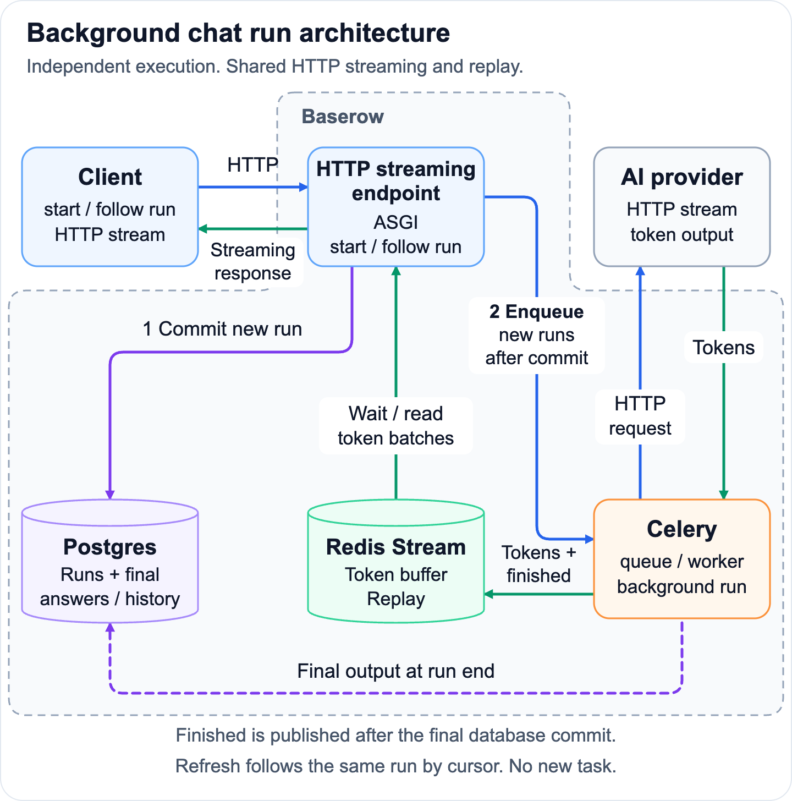

# ADR 010: Execute chat runs in the background

|        |                                                |
| ------ | ---------------------------------------------- |
| Status | Proposed                                       |
| Date   | 2026-10-16                                     |
| Issue  | https://github.com/baserow/baserow/issues/6346 |
| Author | Davide Silvestri (@silvestrid)                 |

## Summary

Chat execution must survive a disconnected client, and clients must be able to
follow the same run after returning. Execute runs in Celery, use Redis Streams
for temporary output and replay, and keep lifecycle and final outcomes in
Postgres. Product adapters let Kuma, agents and other features share execution,
streaming and recovery guarantees.

## Context

Today, Kuma executes model calls and tools while streaming the response to a
message request, and saves the final answer and model history when generation
finishes. Closing the response cleans up its in-process tasks. A refreshed page
can load saved messages, but cannot reattach to the in-progress output.

This makes long-running conversations fragile: users must keep the page open to
follow work, and refreshing or navigating away can interrupt it. Tools may
already have changed Baserow data before the answer is saved, so sending the
prompt again can repeat those changes.

We need this now to improve Kuma's UX: users should be able to leave a page,
return to the same reply, see its outcome and stop that specific run. The agent
builder also needs independent conversation execution, streaming, recovery and
Stop. Other features that need background chat execution and streamed progress
could benefit from the same capability. Establishing a shared, open-source run
lifecycle now gives these consumers common execution and recovery guarantees.

Baserow already runs Postgres, Redis, Celery and an ASGI/Channels stack. The shared
design must work on supported Redis versions and self-hosted deployments. This
decision covers run execution, output delivery, Stop and recovery; each product
defines its API and conversation behavior through an adapter. Model selection,
prompt design and which tools a product exposes are outside its scope. A **run**
is one background execution associated with a conversation; a **follower** is a
client reading its output.

## Decision

### 1. Execute independently of the HTTP request

A feature starts work by committing a queued run and any associated conversation
input, then enqueueing execution after commit. Celery owns execution independently
of the initiating request and any followers. Product adapters supply execution,
tools, permissions and conversation history.
Disconnecting a follower never cancels the run; Stop is a separate operation.

Keep one active run per conversation, per-user limits, execution deadlines,
atomic claims and terminal transitions, and the `chat_run` queue on the existing
export worker. The run engine never restarts failed or interrupted runs or
replays their tool effects. Provider-request and validation retries within a
live run remain product behavior. Stop is run-scoped and finishes after active
tools drain; committed changes remain.

### 2. Stream and replay over HTTP

Deliver ordered run output through an authenticated HTTP stream. A follower
attaches to an existing run by identity and, when available, its last consumed
cursor. Following or reconnecting never creates another message, resubmits a
prompt or enqueues work.

Starting execution and following output are separate responsibilities. A product
adapter can stream on the initiating response or expose a separate follow
request. The adapter chooses endpoints and wire format while using the shared
run lifecycle, output buffer and replay semantics.

Coalesce output into ordered batches in a per-run Redis Stream. Use
`XREAD BLOCK` after the last consumed ID for both replay and waiting, without
consumer groups: every follower needs all events. Use a stable protocol namespace
across application versions. Exclude credentials, execution context and raw tool
arguments.

Refresh rebuilds retained output; reconnect resumes after the last applied
cursor. Ignore duplicates and distinguish recreated buffers by generation.
Suppress live-only effects such as navigation during replay and catch-up,
including in the originating tab. Lightweight websocket notifications may
announce run identity/status to idle tabs; they contain no streamed output and
are not the replay source.

### 3. Bound temporary output and follower resources

Bound buffer size, retention, pending worker output and reconnect attempts.
Active buffers renew for longer than the execution deadline; finished buffers
expire after a reconnect window. Never trim a reconstructable prefix without a
matching Redis-only state baseline. Missing history requires explicit recovery,
not silent application of an incomplete suffix.

A healthy claimed worker continues through output-buffer failure and saves its
final answer from memory. Lease renewal, Stop and deadlines do not wait for Redis
publication. Followers retain known partial output or show that live output is
unavailable, then recover the durable result. A restored buffer may publish an
explicit reset/baseline, but must never repeat execution to recreate history.
Other model/tool dependencies on Redis can still fail normally.

Serve HTTP streaming endpoints through the existing ASGI deployment. Use async
followers with a separate capacity limit and bounded Redis read pool. Long
streams must not occupy ordinary REST admission slots or retain a database
connection or request thread while waiting. Apply authentication, permissions
and CORS explicitly, recheck access during long streams, send compatible
heartbeats and release blocked reads on disconnect. Read permission does not
grant Stop; a run identifier alone grants no access.

### 4. Keep lifecycle and final outcomes in Postgres

Postgres owns creation, active-run constraints, claims, leases, Stop and terminal
status. Read new runs and recovery outcomes from the primary. Save the answer,
model history and terminal status together at run end, then publish completion.
There is no Postgres token-event table or periodic output snapshot, including at
tool boundaries. Human messages, liveness and tool effects retain their durable
writes; tool changes and the generated answer are separate transactions.

Keep a stable association between the run and its saved product outcome.
Followers check durable status when completion is missing and recover the saved
result even if Redis loses the completion event. Conditional terminal transitions
are authoritative: late output or a stale worker cannot overwrite the winner.

### 5. Recover interrupted work without repeating it

| Situation                                                      | Behavior                                                                                                        |
| -------------------------------------------------------------- | --------------------------------------------------------------------------------------------------------------- |
| Refresh or disconnect, Redis history retained                  | Rebuild or resume output; execution continues.                                                                  |
| Output buffer unavailable, claimed worker and Postgres healthy | Continue execution, save the final outcome and let followers recover it.                                        |
| Worker dies, Redis history retained                            | Let its lease expire and save the recoverable partial answer as interrupted.                                    |
| Worker dies and Redis history is missing                       | Save an interrupted outcome; the entire partial answer may be lost.                                             |
| Final outcome committed, Redis completion missing              | Recover the committed outcome from Postgres.                                                                    |
| Final persistence fails                                        | Do not report completion. Record the failure when possible and preserve an interrupted/unavailable-result turn. |

Recovery reads any usable Redis prefix with a bounded read outside the database
transaction. It then locks and rechecks status and lease expiry before ending
the run: a worker may have renewed or finished meanwhile. Missing output cannot
prevent an expired run from ending, and a prefix-less suffix is not a usable
partial answer.

Every started run without a durable complete result must leave or reconstruct
an interruption warning for the next model request: changes may already exist.
Preserve that warning before pruning run metadata, even after a failed product
persistence hook. Only work that provably never started may report that nothing
was done. Persistence retries may save an already-computed outcome, but cannot
repeat model calls or tool effects.

### Decision factors

- **Low latency and less database work.** Redis's in-memory appends suit frequent,
  temporary output. Keeping token batches out of Postgres reduces inserts, WAL,
  index maintenance and cleanup; output is saved durably once at run end.
- **HTTP fits the interaction.** AI text providers commonly stream HTTP responses.
  Run output flows from server to client, while starting work and Stop use
  ordinary requests. Token delivery adds no output traffic to websocket queues.
- **Existing client compatibility.** Kuma can adopt the shared capability while
  retaining its current endpoint and response format through its adapter,
  improving execution and recovery without a client migration.
- **Execution survives the viewer.** Independent workers and replay let users
  refresh or return to existing work without repeating model calls or changes.
- **Shared infrastructure and behavior.** Existing Redis, Celery and ASGI support
  the design without another service. Kuma, agents and other consumers share
  execution, Stop and recovery while keeping their product behavior.
- **Supported Redis versions.** Basic Streams operations predate Baserow's
  [minimum Redis version](../installation/supported.md) of 6.2.7. Keep command
  options compatible with that minimum; no Redis upgrade is required.

## Options considered

| Option                                       | Why not                                                                                                                                   |
| -------------------------------------------- | ----------------------------------------------------------------------------------------------------------------------------------------- |
| Keep execution inside the message request    | Work remains tied to the response, with no independent run to follow after refresh.                                                       |
| Store token events in Postgres               | Adds per-batch writes, WAL, indexes and cleanup for temporary output that Redis can buffer.                                               |
| Stream tokens through websockets/Channels    | Adds a separate output protocol and token traffic to channel queues; channel delivery alone cannot provide replay.                        |
| Use Channels wakeups followed by Redis reads | Can reduce blocked-reader pressure at high follower counts, but adds another queue and recovery path. Revisit if measurements justify it. |

## Consequences

- Clients can disconnect and return to the same run while work continues. Kuma
  gains a more reliable UX; the agent builder and other features can use the
  same execution, streaming and recovery behavior through their adapters.
- Postgres avoids token-event storage and retains authoritative run state and
  final conversation history. Redis consumes bounded memory, and each blocked
  follower consumes a connection; capacity and retention need sizing.
- Exact replay depends on retained Redis history. Combined worker and replay
  loss can lose all partial output, while committed tool changes remain. The UI
  and future model context must explain interrupted or unavailable results.
- Failed or interrupted runs are not restarted automatically. A Redis outage
  may lose queued Celery work, which ends through the not-started timeout. An interrupted worker
  is not resumable, and shutdown grace can interrupt a long run.
- Deployment must route streaming endpoints to ASGI and forward response chunks
  without proxy buffering, with suitable idle timeouts, follower admission limits,
  access rechecks and bounded reconnects. Redis persistence, failover and eviction
  policies must be assessed per installation; another logical Redis database does
  not isolate memory or eviction.

## Revisit triggers

- Measured follower connection pressure makes blocked Redis reads too costly.
- In-progress output must survive simultaneous worker and Redis-history loss.
- Product workflows require resuming interrupted execution, which needs a
  separate decision about idempotency and tool effects.
