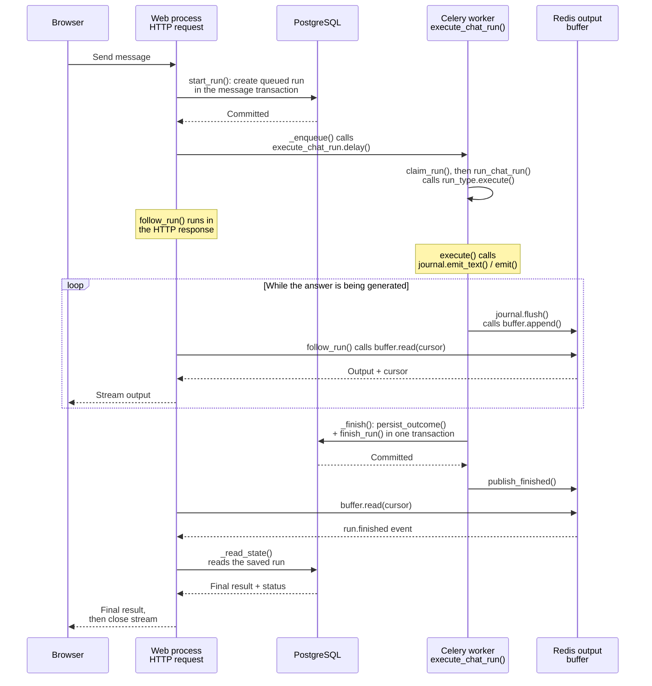
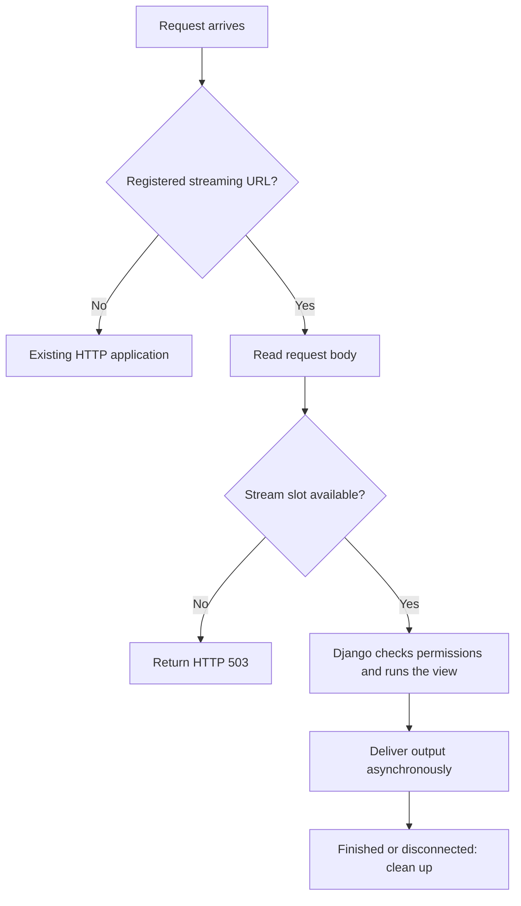

# Background chat runs

An AI answer can take minutes. A chat run computes it in a Celery worker, not
inside the HTTP request. The browser only follows the output. Refreshing the page,
closing the tab or losing the connection does not stop the answer.

Use it for a chat-like feature where a user sends a message and watches a long,
streamed answer, such as Kuma. For a quick request, a normal API view is simpler.

The engine lives in `baserow.core.chat_runs` (backend) and the core `chatRuns`
module (frontend). It does not need enterprise. See
[ADR 010](../decisions/010-background-ai-chat-runs.md) for why it works this way.

## The pieces

- **Run**: a `ChatRun` row in PostgreSQL. It holds the status and, at the end,
  the saved result. It is the source of truth.
- **Worker**: a Celery task. It computes the answer once, by calling the
  product's `execute`.
- **Journal**: what `execute` writes output to. It batches output and sends it to
  the buffer.
- **Buffer**: a Redis stream with a temporary copy of the output. A browser that
  joins late or reconnects replays it from the start. It can be lost.
- **Follower**: one streaming HTTP response that reads the buffer for one browser
  tab. A run can have many followers. Closing one never stops the run.
- **Adapter**: the product's `ChatRunType`. It decides who can see a run, computes
  the answer and saves it into the product's own conversation.



The follower is the API's streaming HTTP response, not another worker. Redis
holds the live output; PostgreSQL holds the saved result. If the browser
disconnects, the Celery worker keeps running.

Websocket messages only say that a run started or ended. They never carry output.

## What runs where

The HTTP request and Celery task run in separate processes. Calling
`execute_chat_run.delay(...)` queues work for Celery; it does not execute the
answer in the web process. After that, the worker and HTTP follower run
independently.

| Context | Caller and method |
| --- | --- |
| HTTP: prepare the response | `AsyncStreamingHTTPRouter.__call__` runs `_prepare` in the web process's thread pool. `_prepare` calls Django's middleware and the product view. |
| HTTP: start a run | The product view calls `ChatRunHandler.start_run`, which calls `create_run`. The view saves the user's message in the same transaction. After commit, `_enqueue` calls `execute_chat_run.delay`. |
| Celery: generate the answer | `execute_chat_run` calls `ChatRunHandler.claim_run`. If it claims the run, it calls `run_chat_run` through `async_to_sync`. The runner awaits the product's `ChatRunType.execute(run, journal)`. |
| Celery: publish output | The adapter calls `journal.emit_text` or `emit`. The runner also starts `journal.keep_flushing`, which calls `flush` and then `ChatRunBuffer.append` to write batches to Redis. |
| Celery: watch for Stop | The runner starts `journal.keep_alive`, which calls `ChatRunHandler.renew_lease` through `sync_to_async`. It sets `journal.stop_requested` when cancellation is requested. The adapter observes it and lets running tools finish. |
| Celery: save the answer | When `execute` returns a `ChatRunOutcome`, the runner calls `_finish` through `sync_to_async`. `_finish` calls the adapter's `persist_outcome` and the handler's `finish_run` in one transaction. After commit, the runner calls `journal.publish_finished`. |
| HTTP: stream output | The view returns an iterator without running it. On the HTTP event loop, `_send_response` consumes the product's iterator, which consumes `follow_run`. The follower calls `ChatRunBuffer.read` to wait for Redis output. |
| HTTP: check durable state | `follow_run` calls `_read_state` through `sync_to_async`. When the stream opens, it calls `ChatRunService.snapshot`, which checks `can_read` once. Later reads skip that check and happen only on `run.finished` or after 5 s without output. Each read calls `serialize_outcome`, which also supplies the final saved result. |

`async_to_sync` and `sync_to_async` bridge synchronous and async code within the
current process. They do not enqueue Celery tasks. The journal's flushing and
lease checks are asyncio tasks inside the existing Celery task.

Refreshing opens a new HTTP follower with the last received cursor. It does not
call `start_run` or enqueue another Celery task. Each `journal.emit_text` call
supplies the whole answer so far; the journal turns it into deltas for Redis.

Stop is a separate HTTP request: `POST /api/chat-runs/<id>/cancel/` calls
`ChatRunService.request_cancel`, which checks `can_cancel` before calling
`ChatRunHandler.request_cancel`. A queued run ends immediately. A running run
gets a cancellation flag, which the worker observes through `keep_alive`.

Some adapter hooks have more than one caller context. `on_run_not_started` can
run in an HTTP request that cancels a queued run or fails to enqueue it, or in
the `sweep_chat_runs` maintenance task. That task also calls `on_run_lost` for
expired runs. `serialize_outcome` is used by both HTTP reads and worker
completion. The `ChatRunType` docstrings describe each hook's callers.

## Adding a product

Register a `ChatRunType` in `chat_run_type_registry` during app startup:

```python
class NotesChatRunType(ChatRunType):
    type = "notes"

    def can_read(self, user, run):  # see output and status
        return run.created_by_id == user.id

    def can_cancel(self, user, run):  # press Stop
        return run.created_by_id == user.id

    def can_follow_chat(self, user, chat_id):  # subscribe to lifecycle updates
        return NotesChat.objects.filter(id=chat_id, user=user).exists()

    async def execute(self, run, journal):
        text = ""
        async for token in ask_model(run.context["prompt"]):
            if journal.stop_requested.is_set():
                return ChatRunOutcome(ChatRunStatus.CANCELLED, result=text)
            text += token
            journal.emit_text(text)
        return ChatRunOutcome(ChatRunStatus.COMPLETED, result=text)

    def persist_outcome(self, run, outcome):
        message = NotesMessage.objects.create(chat_id=run.chat_id, text=outcome.result)
        return {"id": message.id, "text": message.text}
```

The three access checks are separate on purpose: someone may be allowed to see
a run but not stop it. `can_follow_chat` checks websocket subscriptions; HTTP
output followers use `can_read`.

Each run type limits only its own active runs. By default a user can have two
at once; override `get_max_active_runs_per_user` (None for no limit) or
`get_max_active_runs_per_workspace` to change that. At a limit, `create_run`
raises `ChatRunLimitReached`, which the product turns into its own error.

Core serves `GET /api/chat-runs/<run_id>/stream/?cursor=` for every run type. Its
path is registered with the stream router through `register_async_stream_path`
from `baserow.config.streaming`, and deployments route `/api/chat-runs/` to the
ASGI service. A product needs no stream path or view of its own. The endpoint
relays every buffered event to anyone `can_read` admits, so a run type must only
emit output that every reader of the run may see.

On the frontend, register a `ChatRunType` from `chatRuns/chatRunType.js`. By
default it reads that stream and handles the resume baseline: the record that
rebuilds the output before the cursor a follower resumes from. The product only
folds its own events into what the UI shows, in `foldEvent`.

## When things go wrong

The engine never runs an answer twice. Tools may already have changed data, so a
second run could repeat those changes.

| What happens                         | Result                                                                                                               |
| ------------------------------------ | -------------------------------------------------------------------------------------------------------------------- |
| Redis loses the output               | Followers can't replay. The browser uses the saved status and result instead. The worker carries on.                 |
| The worker dies mid-answer           | The run is marked lost. `on_run_lost` gets the output Redis still has, if complete, so the product can save it.      |
| The run never started                | `on_run_not_started` saves a result for it.                                                                          |
| Saving the answer failed             | `ensure_interruption_warning` stores an "answer was interrupted" warning in the product's conversation.             |
| The run is 7 days old                | It is deleted. Incomplete runs first get one more `ensure_interruption_warning` call, which may fail.               |

The buffer always keeps the output from the very start. If a run produces more
output than the buffer allows, replay is turned off for that run. Trimming the
start would rebuild a wrong answer in the browser.

Every event has a cursor. If the buffer is lost and recreated, old cursors are
rejected instead of silently skipping output. Events sent again during a replay
have `replayed: true`, so the product must not repeat side effects for them, such
as navigating the page.

## How streaming responses are served

Django's normal ASGI handler keeps a request-specific thread context until the
response ends. A follower can last minutes, so it uses a separate path:



- The body is read using Django's normal upload handling before a slot is taken.
  A slow upload never holds a slot.
- `BASEROW_ASGI_HTTP_MAX_CONCURRENT_STREAMS` sets the slots per backend process.
  Each follower uses one Redis connection while it waits, so the Redis read pool
  has the same size. For example, 4 processes with 100 slots each can open 400
  Redis read connections.
- Followers don't count against `BASEROW_ASGI_HTTP_MAX_CONCURRENCY`, so long
  answers never block normal requests.
- Redis calls time out after 1 s, including the DNS lookup for a new connection,
  and every run in the worker opens new connections. Where lookups can stall, as
  in some Kubernetes clusters, use a node-local DNS cache: a run whose first
  lookup is slow streams no live output, only its final answer.
