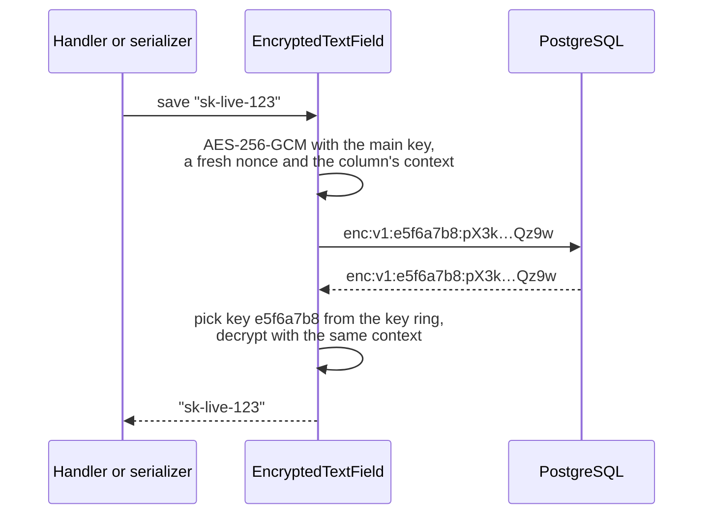
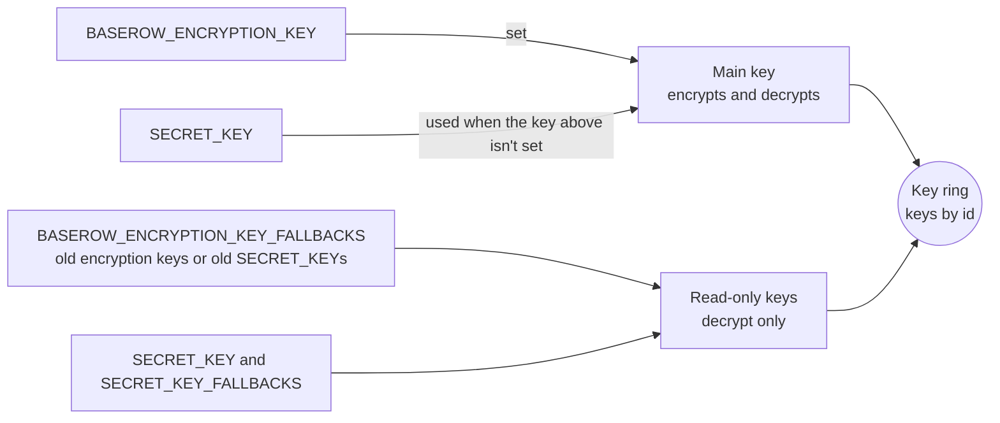
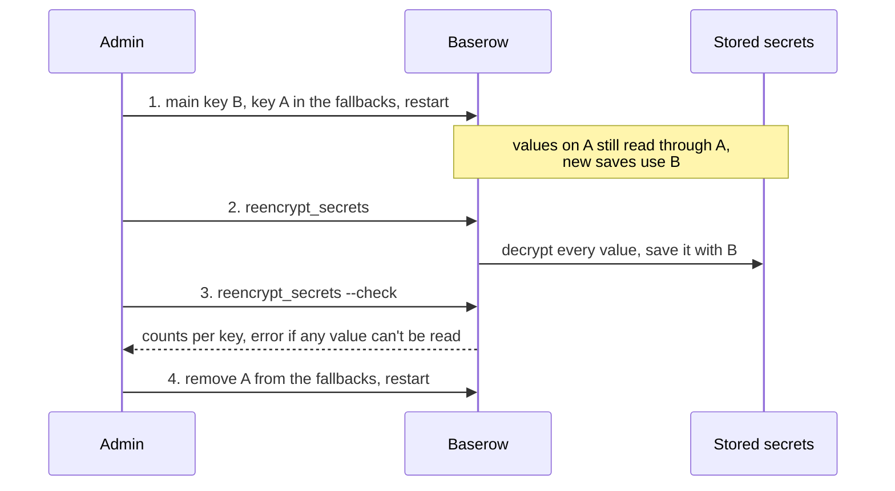
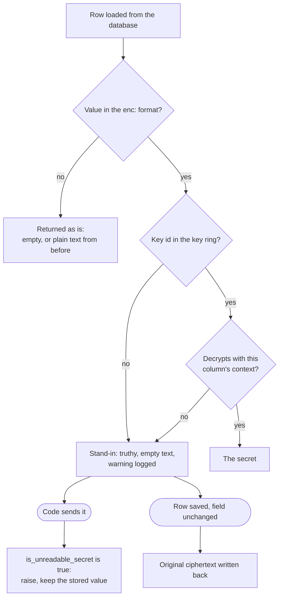

# Storing secrets with EncryptedTextField

This guide is for developers who store a secret Baserow has to send to another service,
such as an API key, an OAuth token or a password for an external database. The decision
behind it is in [ADR 015](../decisions/015-encrypt-stored-secrets.md). How admins set
and change the key is in the installation docs.

Only the four MCP server credentials use the field so far. Every other stored secret is
still plain text until its module moves over.

## When to use it

Use `EncryptedTextField` for a value Baserow must read back in plain text to send
somewhere else. Don't use it for:

- values Baserow only compares, such as user passwords or API tokens it issues. Hash
  those.
- values Baserow looks up or filters by. Each save stores a different ciphertext, so the
  database can't match them.

## Usage

```python
from baserow.core.fields import EncryptedTextField


class SlackBotIntegration(Integration):
    token = EncryptedTextField(
        context="integrations.slackbotintegration.token",
        blank=True,
        default="",
        db_default="",
    )
```

The rest of the code reads and assigns plain strings. Only the database row holds
ciphertext, as `enc:v1:<key id>:<data>`.



| Part    | Example     | What it's for                                                                  |
| ------- | ----------- | ------------------------------------------------------------------------------ |
| Marker  | `enc:`      | Tells encrypted values from plain text saved before the column was encrypted.  |
| Version | `v1`        | Lets the format change later.                                                  |
| Key id  | `e5f6a7b8`  | First 8 hex characters of the key's SHA-256, so reading never tries every key. |
| Data    | `pX3k…Qz9w` | Base64url of the 12-byte nonce, the ciphertext and the 16-byte tag.            |

For an integration, also list the field in its type's `secret_fields`, so the API never
returns it, and in `sensitive_fields`, so workspace exports and the action log leave it
out.

`context` binds every stored value to this column, so a value copied into another column
can't be decrypted. Follow `app_label.model.field`, keep it unique per column, and
**never change it**, also when the app, model or field is renamed. Values stored under
the old context can't be decrypted any more.

Moving an existing column to the field is a migration that changes only the field class.
The column stays `text` and rows aren't rewritten. Existing plain text is read as is and
encrypted on its next save, or by `reencrypt_secrets`. Ciphertext is longer than the
secret, so a `CharField` with a `max_length` has to become a text column first.

## What the database can do with it

| Operation                                             | Allowed   | Why                                                                                                   |
| ----------------------------------------------------- | --------- | ----------------------------------------------------------------------------------------------------- |
| Read, assign, save, `update()`, `bulk_update()`       | Yes       | Values are encrypted on the way in and decrypted on the way out.                                      |
| `filter(token__isnull=True)`                          | Yes       | The only lookup. It only matches `NULL`: empty secrets are stored as `""`, and no lookup finds those. |
| `filter(token="abc")`, `startswith`, any other lookup | No        | Raises an error instead of quietly matching nothing.                                                  |
| `unique=True`, `db_index=True`                        | No        | System check `baserow.E001` stops Baserow at startup.                                                 |
| Ordering or grouping by the column                    | Pointless | Not blocked, but ciphertext order and groups mean nothing.                                            |
| `dumpdata` and `loaddata`                             | Yes       | Dumps keep values encrypted and load them back once.                                                  |

Assigning a ciphertext and saving it encrypts it again; it is never decrypted. Only
`to_python`, which Django uses to load dumps, decrypts its input, so never pass values a
user sent through it, for example with `full_clean()`.

## Where the keys come from

Baserow builds one key ring from the settings. One key encrypts; every other key can
only decrypt values that name it.



Every value is stretched to 32 bytes with HKDF-SHA256, with a different label for
encryption keys and for `SECRET_KEY`, so the same string set as both still gives two
keys. A key shorter than 32 characters, or two keys with the same id, stop Baserow at
startup.

## Changing the key

Old keys stay in the fallbacks until no value needs them. The installation docs have the
full steps for admins.



## A secret that can't be decrypted

When no configured key can decrypt a value, for example after a key changed without the
old one in the fallbacks, reading the row still works. The field returns a stand-in
that:

- is truthy, so checks such as "is a credential set?" still see it, and a change that
  clears the credential still clears it;
- has empty text, which must never be sent;
- writes the original ciphertext back when the row is saved unchanged, so it works again
  once the key is back.



Code that sends the secret must check for it first and fail:

```python
from baserow.core.fields import is_unreadable_secret

if is_unreadable_secret(integration.token):
    raise SlackBotCredentialUnavailable()
```

Never treat it as a missing secret, and never clear or overwrite it because it can't be
read. The MCP integration raises `MCPServerCredentialUnavailable` when connecting or
refreshing a token, and keeps the stored value.

## Failure states

| Situation                                       | What happens                                                         | Fix                                  |
| ----------------------------------------------- | -------------------------------------------------------------------- | ------------------------------------ |
| Key changed, old key not in the fallbacks       | Secret can't be used, a warning names the key id it needs            | Add the old key to the fallbacks     |
| Value copied to another column or edited        | Secret can't be used, a warning says it can't be decrypted           | Enter the secret again               |
| Key lost and no backup                          | Every secret encrypted with it can't be used                         | Enter the secrets again              |
| `reencrypt_secrets` meets a value it can't read | Moves the rest, then exits with an error and the count               | Add the missing key and run it again |
| Key too short, or two keys with the same id     | System check `baserow.E002` stops Baserow at startup                 | Use another key                      |
| No key configured                               | A key derived from `SECRET_KEY` is used and a warning is logged once | Set a dedicated key                  |

## Tests every adopter keeps

The shared field is covered in `backend/tests/baserow/core/test_encryption.py`. A module
that adopts it adds tests for its own code paths:

- the secret is stored encrypted and reads back as the original;
- a value that can't be decrypted still loads the row and is never sent: the code that
  uses it raises an error instead;
- a value that can't be decrypted is kept by a save, a token refresh or any background
  job, and only cleared by an action that would clear a readable one too;
- checks that ask whether a secret is set, such as asking for it again when the target
  URL changes, still see a value that can't be decrypted;
- the API never returns the secret, encrypted or not;
- workspace exports leave the secret out, and importing them works without it;
- `reencrypt_secrets` moves the module's values to a new key.
