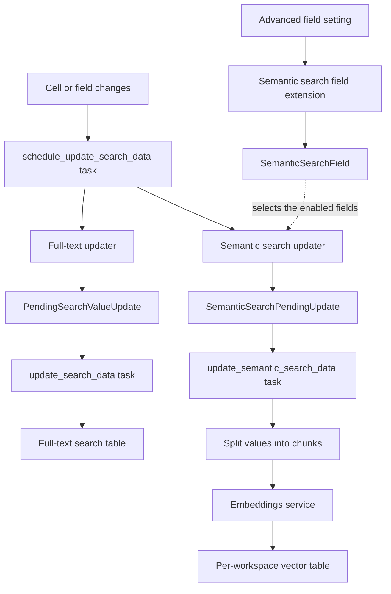

# Search data updaters and semantic search

[ADR 012](../decisions/012-semantic-search.md) records why semantic search reuses the
full-text search lifecycle. This document explains how the parts work together and
where they live.

## Glossary

| Term                   | Meaning                                                                                                                                        |
| ---------------------- | ---------------------------------------------------------------------------------------------------------------------------------------------- |
| Search data            | Data derived from cell values to search them, like full-text search vectors or semantic search chunks. Cell values remain the source of truth. |
| Search data updater    | Keeps one kind of search data up to date: which fields it covers, how it processes pending updates and how it recovers from failures.          |
| Pending update         | A queued row of an updater, for one cell (`row_id` set) or for all rows of a field (`row_id` null).                                            |
| Update task            | The Celery task of an updater, a singleton per table, that processes the pending updates in the background.                                    |
| Field extension        | Adds plugin-owned values to every field, without changing the field type.                                                                      |
| Advanced field setting | The frontend component of a field extension in the Advanced tab of the field form.                                                             |
| Chunk                  | A part of a cell value, small enough to embed, that overlaps with the previous one.                                                            |
| Embedding              | The vector of a chunk, returned by the embeddings service and stored with pgvector.                                                            |

## Code

| Part                    | Location                                                                                                              |
| ----------------------- | --------------------------------------------------------------------------------------------------------------------- |
| Updater engine          | `backend/src/baserow/contrib/database/search/registries.py` (`SearchDataUpdaterType`, `search_data_updater_registry`) |
| Full-text updater       | `backend/src/baserow/contrib/database/search/search_data_updater_types.py`                                            |
| Tasks                   | `backend/src/baserow/contrib/database/search/tasks.py`                                                                |
| Field extensions        | `FieldExtensionType` and `field_extension_registry` in `backend/src/baserow/contrib/database/fields/registries.py`    |
| Advanced field settings | `web-frontend/modules/database/fieldFormAdvancedSettingTypes.js`                                                      |
| Embeddings and chunking | `backend/src/baserow/core/embeddings.py`, `backend/src/baserow/core/text_chunking.py`                                 |
| Semantic search         | `enterprise/backend/src/baserow_enterprise/semantic_search/`                                                          |

## How the parts connect

`schedule_update_search_data` asks every updater which of the changed fields it covers.
Each updater queues its pending updates first, then all their tasks are scheduled, so a
failure to schedule one never loses the changes of another. A task processes updates of
all rows of a field first, then single cells in batches, and only deletes the updates
that were queued before it read them, so changes made in the meantime are processed by
a next run. When a task runs out of its time budget, or new changes arrived while it
ran, it reschedules itself. The periodic check every 15 minutes starts the tasks of
tables that still have pending updates, for example after a worker restart.

## Example

1. A user enables semantic search on a **Support notes** long text field. The field
   form sends `semantic_search_enabled` with the other field values, the extension
   checks the license and the instance, creates the `SemanticSearchField` and queues an
   update of all rows of the field.
2. The semantic search task indexes the rows in batches: it reads the values, skips the
   cells of which the content hash is unchanged, chunks and embeds the others outside a
   transaction, and replaces their chunks. The field's status changes from `indexing`
   to `ready` in realtime.
3. The user changes a cell from **Parcel arrived intact** to **Parcel arrived
   damaged**. Both updaters queue a pending update for the cell; full-text search
   updates its data, semantic search embeds the new value and replaces its chunks.
4. If the embeddings service is down, the pending updates are kept and retried with a
   backoff, and the field shows `error` after a few failures. Full-text search isn't
   affected.

## Boundaries

- Without pgvector, the embeddings service or the Advanced plan, the setting is kept
  but indexing pauses, and the field shows `unavailable` or `paused`.
- Disabling semantic search, converting the field to an unsupported type, or
  permanently deleting the field, table or workspace deletes its vectors. Trashed
  items keep them, so restoring doesn't embed everything again.
- Searching the index, including ranking and permissions, belongs to the semantic
  search action, not to the updaters.
